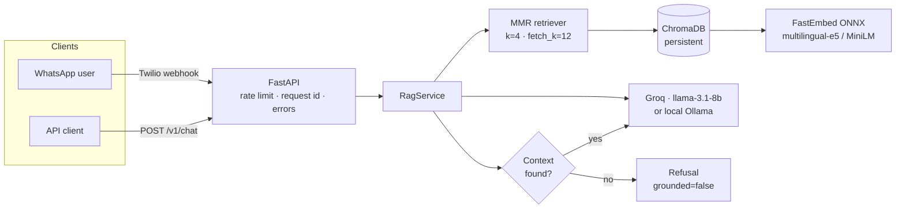

# Hindi RAG Service

Production-grade retrieval-augmented question answering in **Hindi**, with grounded citations, refusal on missing context, and WhatsApp delivery.

[](https://github.com/swajayresources/hindi-rag-whatsapp/actions/workflows/ci.yml)
[](https://www.python.org/downloads/)
[](LICENSE)

---

## Why this exists

Most "RAG" portfolio projects are a notebook that embeds a PDF and calls an LLM. This one is built like a service:

| Concern | How it is handled here |
|---|---|
| **Retrieval quality** | MMR retrieval (not plain top-k) to avoid near-duplicate context |
| **Grounding** | Hindi system prompt that refuses when the answer is absent; refusal detected and surfaced as `grounded: false` |
| **No wasted spend** | If retrieval returns nothing, the LLM is never called |
| **Hindi correctness** | Devanagari-aware chunking (splits on `।`), multilingual ONNX embeddings, Hindi output contract |
| **Security** | Twilio signature validation on the webhook, per-client rate limiting, input caps |
| **Reliability** | Retries with exponential backoff + jitter, request timeouts, typed configuration validated at startup |
| **Observability** | Structured JSON logs with request ids, latency, context size and grounding outcome |
| **Testability** | 47 unit tests, dependency-injected RAG service, no network required |
| **Deployability** | Multi-stage non-root Docker image, health/readiness probes, Render blueprint |

---

## Architecture



Ingestion is a separate, idempotent step:

```
data/corpus/*.txt|pdf → load → Hindi-aware chunking → embed → Chroma
```

---

## Measured results

Reproduced with the committed evaluation set (`data/eval/questions.jsonl`, 26 questions whose ground-truth answers were **programmatically verified to exist in the corpus**):

| Metric | Value | Notes |
|---|---|---|
| **hit@4** | **0.769** | correct source document retrieved in top-4 |
| **recall@4** | **0.769** | (single relevant source per question) |
| **MRR** | **0.593** | mean reciprocal rank of the correct source |
| Corpus | 21 documents → 1,785 chunks | Hindi Wikipedia |
| Retrieval | MMR, `k=4`, `fetch_k=12`, `lambda=0.5` | |

Answer-level metrics (accuracy, refusal rate, latency) require an LLM backend; run:

```bash
make evaluate            # retrieval + answers (needs GROQ_API_KEY or Ollama)
make evaluate-offline    # retrieval only, no API calls
```

RAGAS judge metrics (`faithfulness`, `answer_relevancy`, `context_precision`) are available behind an optional extra:

```bash
pip install ".[eval]"
hindi-rag evaluate --ragas
```

> **Honest caveat:** 26 questions is a smoke-scale benchmark, not a leaderboard. The set is small because every ground truth is verified against the corpus rather than generated. Extend it with `scripts/build_eval_set.py` (it drops any fact it cannot find in the cited file).

---

## Quickstart

### Docker (recommended)

```bash
cp .env.example .env          # add GROQ_API_KEY (free at console.groq.com)
docker compose up --build
curl -s localhost:8000/health | jq
curl -s localhost:8000/v1/chat \
  -H 'content-type: application/json' \
  -d '{"question":"भारत की राजधानी क्या है?"}' | jq
```

### Local

```bash
python -m venv .venv && source .venv/bin/activate   # Windows: .venv\Scripts\activate
pip install -e ".[dev]"
cp .env.example .env
hindi-rag ingest            # build the vector index (idempotent)
hindi-rag serve             # http://localhost:8000/docs
```

### Deploy to Render

`render.yaml` is committed. Set `GROQ_API_KEY`, `TWILIO_ACCOUNT_SID`, `TWILIO_AUTH_TOKEN` as secret env vars in the dashboard; the service auto-ingests on first boot.

---

## API

| Method | Path | Purpose |
|---|---|---|
| `GET` | `/health` | dependency-aware health (vector store, LLM credentials) |
| `GET` | `/ready` | readiness (fails until the index is populated) |
| `POST` | `/v1/chat` | ask a question, get answer + sources + grounding flag |
| `POST` | `/whatsapp/webhook` | Twilio TwiML webhook (signature-verified) |
| `GET` | `/docs` | OpenAPI UI |

```bash
curl -s localhost:8000/v1/chat -H 'content-type: application/json' -d '{
  "question": "भारत की राजधानी क्या है?",
  "include_sources": true
}'
```

```json
{
  "question": "भारत की राजधानी क्या है?",
  "answer": "भारत की राजधानी नई दिल्ली है।",
  "sources": [{"source": "भारत.txt", "snippet": "...", "score": null}],
  "grounded": true,
  "latency_ms": 842.3,
  "request_id": "3f2a9c1d8b7e4a60"
}
```

Errors are structured and always carry the request id:

```json
{"error": "rate_limited", "detail": "Too many requests. Please retry shortly.", "request_id": "..."}
```

---

## Configuration

All settings are environment variables (see `.env.example`); invalid combinations fail at startup.

| Variable | Default | Notes |
|---|---|---|
| `ENVIRONMENT` | `development` | `production` enables strict credential checks |
| `LLM_BACKEND` | `groq` | `groq` or `ollama` |
| `GROQ_API_KEY` | — | required when `LLM_BACKEND=groq` |
| `GROQ_MODEL` | `llama-3.1-8b-instant` | |
| `EMBEDDING_MODEL` | `sentence-transformers/paraphrase-multilingual-MiniLM-L12-v2` | ONNX via FastEmbed |
| `RETRIEVAL_K` / `RETRIEVAL_FETCH_K` | `4` / `12` | MMR candidate pool must be ≥ k |
| `MMR_LAMBDA` | `0.5` | relevance vs diversity |
| `CHUNK_SIZE` / `CHUNK_OVERLAP` | `512` / `64` | overlap must be < size |
| `TWILIO_VALIDATE_SIGNATURE` | `true` | disable only for local webhook tests |
| `RATE_LIMIT_REQUESTS` / `RATE_LIMIT_WINDOW_S` | `30` / `60` | per client IP |
| `MAX_QUESTION_CHARS` | `1000` | input cap |

---

## Design decisions

- **MMR over plain similarity.** With 1,785 chunks from overlapping Wikipedia articles, plain top-k frequently returns three near-identical passages and one useful one. MMR spends the context budget on distinct information.
- **Refuse instead of hallucinate.** The prompt forbids outside knowledge and prescribes an exact refusal string; the service detects it and reports `grounded: false` rather than pretending the answer is trustworthy.
- **No LLM call without context.** Saves cost and makes the failure mode explicit.
- **Twilio signature verification on by default.** An unauthenticated webhook is a free denial-of-wallet endpoint.
- **Explicit orchestration instead of an opaque chain.** Retries, timeouts, refusal detection and logging are first-class, not hidden inside LCEL callbacks.
- **Retrieval-only evaluation mode.** Lets CI and ablation runs measure retrieval quality with zero API spend.

---

## Project layout

```
src/hindi_rag/
  config.py          validated settings (pydantic-settings)
  logging_config.py  JSON structured logging
  schemas.py         request/response contracts
  ingestion.py       load → Hindi-aware chunk → index (idempotent)
  retrieval.py       Chroma + FastEmbed + MMR (no private APIs)
  generation.py      RagService: retries, grounding, refusal
  evaluation.py      hit@k / MRR / answer accuracy / optional RAGAS
  whatsapp.py        Twilio signatures, truncation, fallbacks
  api/
    app.py           app factory, probes, error handlers
    middleware.py    request ids, latency, rate limiting
tests/               47 unit tests, no network or vector DB required
scripts/             eval-set builder + thin CLI wrappers
data/corpus/         21 Hindi documents
data/eval/           verified questions + latest report
```

---

## Development

```bash
make install        # editable install + dev tools
make lint           # ruff
make typecheck      # mypy
make test           # pytest
make cov            # coverage report
make evaluate-offline
```

CI runs lint, type-check and tests on Python 3.11 and 3.12.

---

## Limitations & roadmap

- **Corpus is Wikipedia**, not a business domain. Swapping `data/corpus/` for leases/specs is a config change, not a rewrite.
- **Single-process rate limiter.** Move to Redis for horizontal scaling.
- **No reranker.** A cross-encoder rerank over the MMR shortlist is the highest-leverage next retrieval win.
- **No conversation memory.** Each question is independent by design.
- **Answer scoring is substring-based.** RAGAS is available but optional; a judged metric should be the default once a stable judge model is pinned.

## License

MIT — see [LICENSE](LICENSE).
